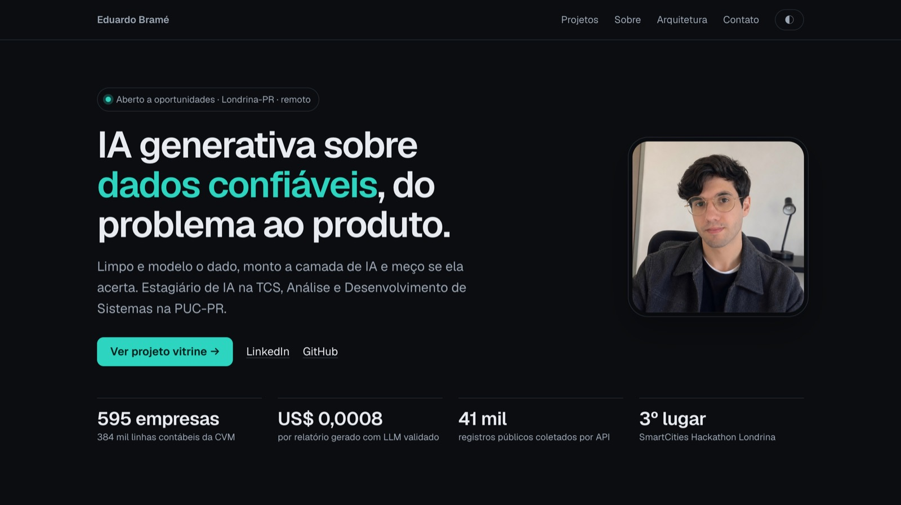

# Eduardo Bramé · IA aplicada com base em dados

**[eduardobrame.github.io](https://eduardobrame.github.io)**

IA generativa sobre dados confiáveis, do problema ao produto.

## Projetos

| Projeto | O que é | Demo |
|---|---|---|
| [Raio-X Comercial](https://eduardobrame.github.io/projetos/raio-x.html) | Briefing de vendas B2B com dados da CVM; o LLM não escreve números, o código confere | — |
| [Bike Store](https://eduardobrame.github.io/projetos/bike-store.html) | Limpeza em views SQL e modelo estrela no PostgreSQL | [código](https://github.com/EduardoBrame/bike-store-sql) |
| [Árvore Segura](https://eduardobrame.github.io/projetos/arvore-segura.html) | Fila de vistoria de árvores a partir de dados públicos da prefeitura | [mapa ao vivo](https://eduardobrame.github.io/demos/arvore-segura.html) |
| [Cérebro](https://eduardobrame.github.io/projetos/cerebro.html) | Assistente 24 h na Azure com roteamento de modelos por custo | — |
| [Varejo](https://eduardobrame.github.io/projetos/varejo.html) | ETL com uma regra explícita para cada problema de dado | — |
| [DRINA](https://eduardobrame.github.io/projetos/drina.html) | 3º lugar no SmartCities Hackathon Londrina | [Onde Resolvo](https://eduardobrame.github.io/demos/onde-resolvo.html) |

---

HTML e CSS puros, sem build. As páginas de projeto saem de `gerar.py`; ao mudar o CSS, suba `V` no script e o `?v=` no `index.html`.
